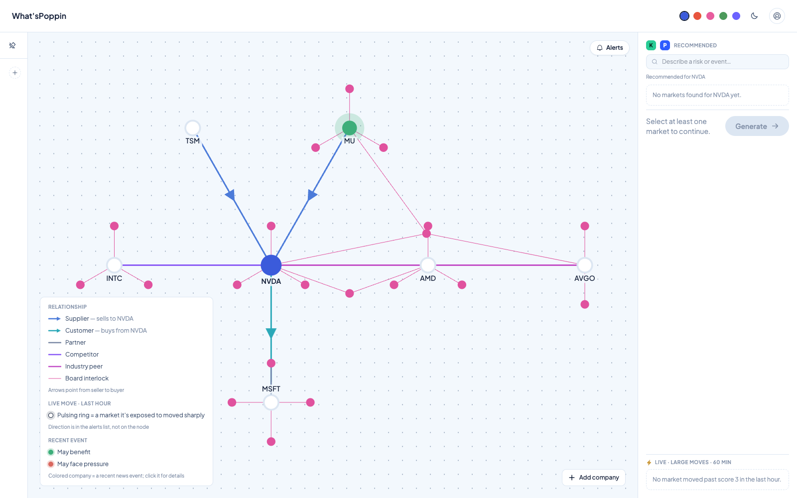
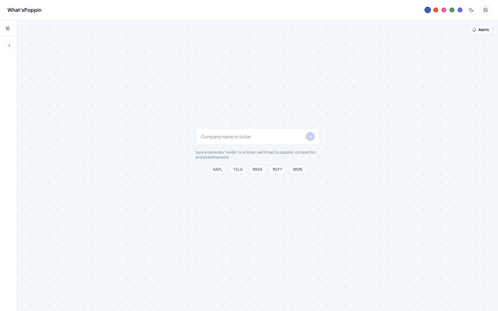
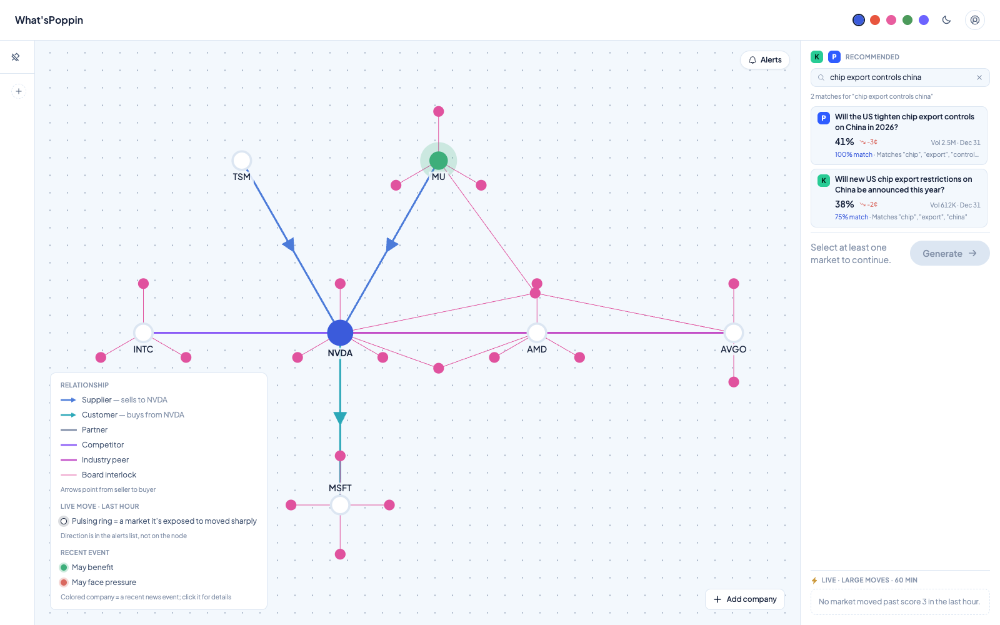
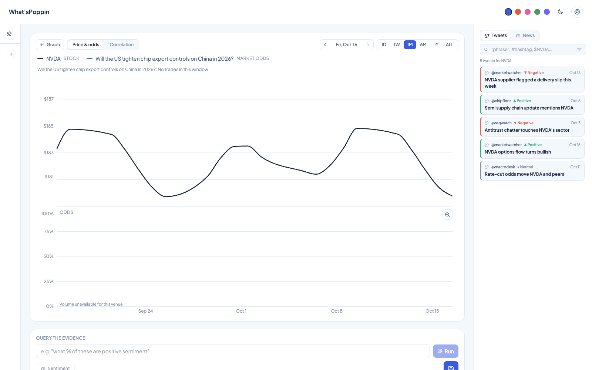
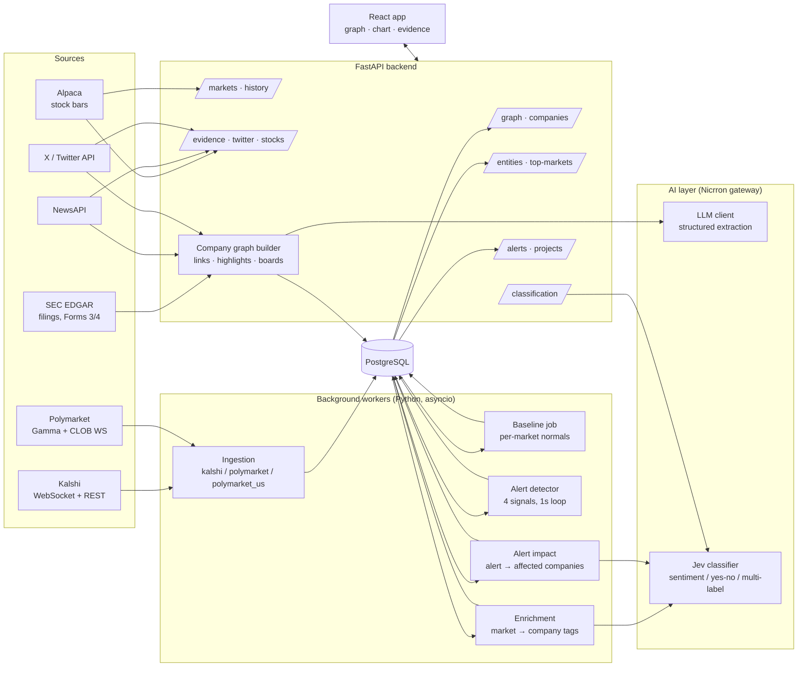

# What'sPoppin

**Prediction markets, news and social chatter, mapped to the companies they move.**

What'sPoppin watches Kalshi and Polymarket in real time, works out which public
companies each market actually matters to, and lines the market's odds up
against the stock price, with the news and X posts that explain the moves.
When a market makes an unusual move, it flags it and traces it through a
supply-chain graph built from SEC filings to every company that may feel it.



---

## The problem

Prediction markets now price real-world events minute by minute: Fed decisions,
export controls, tariffs, earnings, elections. That is an early, liquid read on
risks that hit stocks. But using it today means:

- **Thousands of markets, no map to companies.** Nothing tells you that a
  "chip export controls" market matters to NVIDIA, its supplier TSMC and its
  competitor AMD.
- **Moves are noticed late.** Nobody watches every market by hand. Most
  people find out from social media after the move is priced in.
- **"Why did it move?" is manual work.** Connecting an odds jump to a stock
  move and to the headline behind it means juggling five tabs.

## What What'sPoppin does

| | |
|---|---|
| **Company graph** | Search any listed company. Its suppliers, customers, partners, competitors and board interlocks are extracted from SEC 10-K/10-Q and insider filings, each link with the filing it came from. |
| **Markets that matter** | Every open Kalshi and Polymarket market is tagged by an LLM with the companies, sectors and themes it affects. A company gets its own markets first, then its linked companies' markets, then markets matching its themes. Or describe a risk in plain English ("chip export controls china") and get matching markets. |
| **Price vs. odds** | The stock and the market's odds on one timeline (1D to all-time), market-adjusted against SPY, with a correlation and lead/lag readout. |
| **Evidence on the chart** | Pull in news articles and X posts. Each one is classified for sentiment and pinned to the moment it was published, so you can see what came before the move. |
| **Ask the evidence** | Run questions over the evidence you collected, e.g. *"what % of these are about supply-chain risk?"* |
| **Live alerts** | A detector scores every market every second against its own history (price z-score, volume bursts, whale orders, order-flow imbalance) and raises an alert only on real moves. Each alert is matched to the companies it may affect, and their nodes pulse on the graph. |
| **Projects** | Save an analysis (graph, markets, evidence, range) and reopen it later. |

### Walkthrough

| 1. Search a company | 2. Find the markets that matter |
|---|---|
|  |  |

| 3. Stock vs. market odds, with evidence |
|---|
|  |

---

## Architecture



### How data flows

1. **Ingestion** workers stream live quotes and trades for the most-traded open
   markets into `markets`, `market_prices` and `market_trades`. Every venue is
   normalized to the YES side's point of view, keyed by `(source, market_id)`.
2. The **baseline job** pulls days of history per market and stores its normal
   5-minute move, normal dollar volume and 99th-percentile order size.
3. The **alert detector** re-scores every updated market once a second against
   that baseline and writes an `alerts` row (with a Postgres `NOTIFY`) when a
   move is real.
4. **Enrichment** tags each market event with the companies and themes it
   affects (`market_entities`), using a two-pass classifier: categories first,
   then entities within them.
5. **Alert impact** listens for new alerts and matches each one to companies
   in three tiers:
   - **Tier 1:** the market names the company directly.
   - **Tier 2:** the company is linked in the graph to a tier-1 company.
   - **Tier 3:** the classifier judges the company relevant.
6. The **company graph** is built on demand when a company is first searched:
   - **Links:** filings are trimmed to relationship passages, then the LLM
     extracts each relationship with its evidence URL.
   - **Highlights:** recent news, X posts and alerts about linked companies are
     classified for impact.
   - **Boards:** directors are read from Forms 3 and 4.
   - Everything is cached in Postgres with a TTL.
7. The **React app** reads all of this over REST. Charts are fetched live from
   the venue (Kalshi candlesticks, Polymarket price history) and from Alpaca,
   then aligned on one clock.

### The alert signals

The detector looks at a 5-minute window and compares it against each market's
own baseline. It never uses one global threshold.

| Signal | Fires when |
|---|---|
| **Price move** | \|z\| ≥ 3, where z = 5-min midpoint move ÷ typical 5-min move. Good quotes only (two-sided book, spread ≤ 10 pts). |
| **Volume burst** | Dollars traded ≥ 5× normal and ≥ $300. |
| **Whale** | A single order larger than the market's 99th-percentile order (≥ $500). |
| **Imbalance** | ≥ 60% of taker dollars on one side. Only counts alongside a burst. |

Alerts are grouped by event: the strongest strike is the alert and the others
are context. A 10-minute cooldown applies unless a new move scores 1.5× the
last one. Markets that are near close, pinned near 0/1, or have just reconnected
are excluded.

### AI layer

All model calls go through the **[Nicrron](https://nicrron.ai) gateway**
(OpenAI-compatible, `nicrron/auto` routing by default), so models can be swapped
with one setting and no code changes.

- **`backend/llm`:** structured extraction. The model's JSON is validated
  against a Pydantic schema, and invalid output is rejected rather than guessed.
- **`backend/classification` (Jev):** a typed question contract with three
  question types: `noul` (yes/no probability), `choice` (one label with
  per-label probabilities) and `score` (ordered rubric). On top of these sit
  the sentiment, boolean, choice, multi-select and score modes. Answers are
  normalized to the same calibrated shape whichever model answers them.
- **Grounding rules:** every graph link and highlight must carry a source URL
  from a real fetch in that run. Nothing is saved from model memory, and no
  wording predicts a price or suggests a trade.

---

## Tech stack

| Layer | Choice |
|---|---|
| Backend | Python 3.11+, FastAPI, SQLAlchemy 2 (async) + asyncpg, httpx, Pydantic 2, `uv` |
| Database | PostgreSQL (tables created from the models; no migrations) |
| Frontend | React 18, TypeScript, Vite, Tailwind, Radix Themes, Motion, react-force-graph-2d, Recharts |
| AI | Nicrron gateway (`nicrron/auto`); optional TypeSafe Jev, Anthropic |
| Data | Kalshi, Polymarket (global + US), SEC EDGAR, NewsAPI, X API, Alpaca |
| Tests | pytest (640+ tests), Vitest (118 tests) |

## Repository layout

```
backend/
  main.py              FastAPI app: CORS, error handling, routers
  api/                 REST routes (graph, entities, markets, evidence, classification, alerts, projects…)
  ingestion/           kalshi/, polymarket/, polymarket_us/, alpaca/, news_api/, twitter_lookup/, common/
  enrichment/          market → company tagging worker + search queries
  alert_impact/        alert → affected companies worker (tiers 1–3)
  classification/      Jev question contract, modes, relevance filter, sentiment cache
  llm/                 structured-output LLM client (Nicrron / OpenRouter / Gemini)
  entities/            entity map (companies, sectors, themes) + matcher
  evidence/            news fetch + cache
  models/              SQLAlchemy models, one per table
alert_detector/        live signal detector (signals.py = pure maths)
baselines/             per-market "normal" computed from history
company_graph/         SEC client, filing trimmer, relationship extractor, links, highlights, boards
frontend/src/
  features/workspace/  graph, markets panel, market view (chart, evidence), alerts, projects
  lib/                 API client, chart maths (alignment, correlation, lead/lag)
new_specs/             design specs per feature
mock_db_design/        database design
scripts/               init_db.py, benchmarks, tunnels
tests/                 backend tests mirroring the package layout
```

---

## Run it locally

**Requirements:** Python 3.11+ with [uv](https://docs.astral.sh/uv/), Node 20+, PostgreSQL.

```bash
# 1. Configure
cp .env.example .env                    # set DATABASE_URL and your keys (see below)
cp frontend/.env.example frontend/.env

# 2. Install
uv sync
(cd frontend && npm install)

# 3. Create the database tables (once; safe to re-run)
uv run python scripts/init_db.py

# 4. Start the API (http://localhost:8000) and the web app (http://localhost:5173)
uv run uvicorn backend.main:app --reload
cd frontend && npm run dev
```

Open **http://localhost:5173**. The API's CORS only allows the app on port 5173.

> **No SEC setup yet?** Set `GRAPH_FAKE=1` in `.env` to use built-in graphs for
> AAPL, NVDA and TSLA with no outside calls.

### Live data workers

Run each in its own terminal:

```bash
uv run python -m backend.ingestion.polymarket   # live Polymarket markets + prices (no key)
uv run python -m backend.ingestion.kalshi       # live Kalshi markets + prices
uv run python -m baselines                      # per-market baselines (needed by the detector)
uv run python -m backend.enrichment             # tag markets with the companies they affect
uv run python -m alert_detector                 # unusual-move alerts
uv run python -m backend.alert_impact           # alert → affected companies
```

## Configuration and API keys

| Variable | Used for | Get it at | Without it |
|---|---|---|---|
| `DATABASE_URL` | Everything stored: markets, alerts, graph, projects | any Postgres | Most features unavailable |
| `NICRRON_API_KEY` (+ `NICRRON_MODEL`, default `nicrron/auto`) | All LLM + classifier calls: market tagging, sentiment, evidence queries, graph extraction | [nicrron.ai](https://nicrron.ai) | No recommended markets; rough sentiment fallback |
| `SEC_CONTACT_EMAIL` | SEC EDGAR access (an email, not a key) | — | Use `GRAPH_FAKE=1` |
| `ALPACA_API_KEY_ID` / `ALPACA_API_SECRET_KEY` | Stock prices | [alpaca.markets](https://app.alpaca.markets) (free) | Placeholder stock line |
| `NEWSAPI_KEY` | News evidence + graph highlights | [newsapi.org](https://newsapi.org) (free) | Placeholder news |
| `X_BEARER_TOKEN` | X posts as evidence + highlights | [developer.x.com](https://developer.x.com) | Placeholder posts |
| `KALSHI_API_KEY_ID` + `KALSHI_PRIVATE_KEY_PATH` | Kalshi live stream | kalshi.com → API keys | Kalshi charts still work (public) |
| `POLYMARKET_US_KEY_ID` / `_SECRET_KEY` | Polymarket US stream | polymarket.us/developer | Global Polymarket needs no key |
| `TYPESAFE_API_KEY` | Optional: native Jev model | typesafe.ai | Classifier runs on Nicrron |
| `OPENROUTER` | Optional fallback provider | openrouter.ai | — |

All tuning knobs (alert thresholds, cache TTLs, daily API budgets) are
documented in [`.env.example`](.env.example).

## API overview

| Route | What it returns |
|---|---|
| `GET /companies/search?q=` | Company autocomplete (SEC list) |
| `GET /graph/{ticker}` | Company graph: nodes, links with evidence, highlights (polled while building) |
| `GET /graph/{ticker}/board` · `/graph/{ticker}/news/{other}` | Directors · news about two linked companies together |
| `GET /entities/{company}/top-markets` | Markets that matter to a company, ranked by tier |
| `GET /markets/{id}/history?stock=&range=` | Market odds + stock bars on the same interval |
| `GET /evidence/news` · `GET /twitter/search` | Candidate evidence items |
| `POST /classification/sentiment` · `/query` | Per-item sentiment · % of evidence answering a question |
| `GET /alerts/recent` · `/entities/{company}/alerts` | Live alerts with affected companies |
| `GET/POST/PUT/DELETE /projects` | Saved analyses |

Interactive docs are served at `http://localhost:8000/docs` while the API runs.

## Tests

```bash
uv run pytest                 # backend; set SEC_CONTACT_EMAIL for the SEC client tests
cd frontend && npm test       # frontend
```

Tests never call the network, a real model or a real database: HTTP uses mock
transports and tables use SQLite.

## Roadmap

- Backtest alert thresholds on historical Kalshi/Polymarket data (false-positive
  rate, does the move lead the stock).
- An LLM explainer that writes the "why it moved" summary for each alert from
  the matched news and posts.
- Trending cards: a ranked feed of the day's biggest market moves by sector.
- User accounts, watchlists and push notifications.

## Security note

The API has no authentication and is meant for local use. Add auth before
exposing it on a network. Keys live only in `.env`, which is gitignored.
